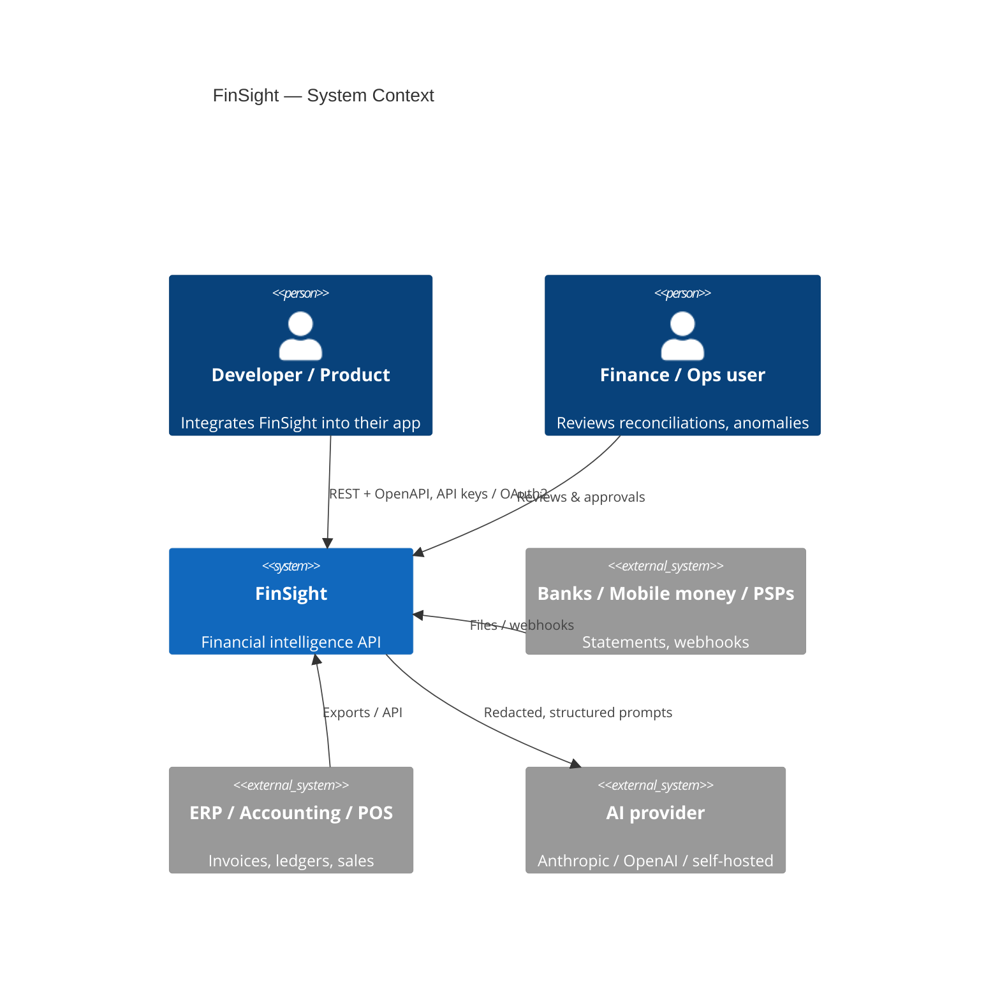
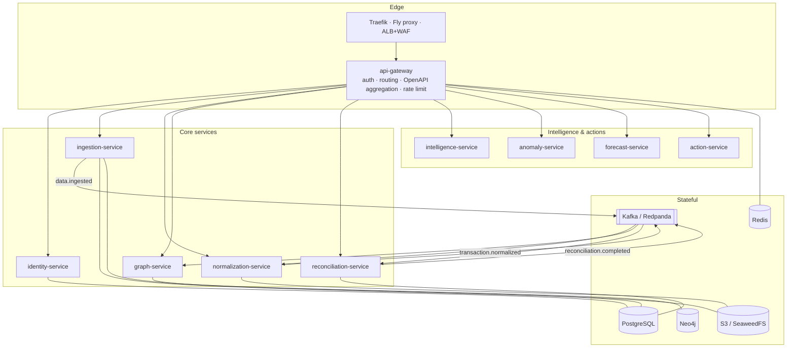

# FinSight — Architecture

## 1. Context



## 2. Containers



## 3. The data model

### Universal Financial Schema (`finsight_common.schemas.financial`)

Every inbound record — bank line, mobile-money transfer, invoice, receipt, POS sale, ledger
entry — becomes a `FinancialRecord`: typed, amount in integer **minor units**, ISO-4217
currency, resolved parties (with a canonical `normalized_name` for entity resolution),
`raw_ref` back to the original bytes, and a `confidence`.

### Financial graph (`graph-service`, Neo4j)

```
Customer ─PLACED→ Order ─BILLED_BY→ Invoice ←PAYS─ Payment ─SETTLED_BY→ BankTransaction ─HELD_IN→ Account
```

Nodes carry `(tenant_id, id)` uniqueness. The graph is what lets FinSight answer
"why is this payment unmatched?" and "what invoices are behind this bank line?".

## 4. Event backbone

JSON events wrapped in `EventEnvelope`, topic naming `finsight.<domain>.<event>.v<major>`.
Producers use the **transactional outbox** (`finsight_common.messaging.outbox_sql`) so a domain
write and its event commit atomically; a relay publishes to Kafka at-least-once. Consumers are
idempotent (dedupe on record / ingestion id).

| Event | Producer → Consumers |
|---|---|
| `data.ingested` | ingestion → normalization |
| `transaction.normalized` | normalization → graph, reconciliation, (anomaly) |
| `graph.updated` | graph → (intelligence) |
| `reconciliation.completed` | reconciliation → (notifications, audit) |
| `anomaly.detected` | anomaly → (action, notifications) |
| `audit.recorded` | every service → audit store |

## 5. Cross-cutting

* **Auth:** OAuth2 client-credentials + API keys → RS256 JWT (JWKS rotation). Per-endpoint
  scopes via `require_scopes(...)`. Hard tenant isolation on every query.
* **Observability:** OpenTelemetry traces (→ Jaeger), Prometheus `/metrics`, structlog JSON
  logs with `trace_id` correlation and PII redaction. `/health` + `/ready` on every service.
* **Errors:** RFC 9457 `application/problem+json` everywhere.
* **Config:** 12-factor via `pydantic-settings`, `FINSIGHT_` prefix.

## 6. Deployment topologies

The same images run in three places. Traefik is the edge only in local Compose.

| | Local (Compose) | Fly.io (live) | AWS (EKS) |
|---|---|---|---|
| Edge | Traefik → gateway | Fly proxy (TLS) → gateway | ALB + WAF (ACM TLS) → gateway |
| Kafka | Redpanda | Redpanda app (private) | MSK, SASL/SCRAM over TLS |
| PostgreSQL | one container, a DB per service | Fly Postgres, a DB **and user** per service | RDS Multi-AZ, a login per service, TLS enforced |
| Neo4j | container | Neo4j app (private, volume) | StatefulSet in the cluster |
| Object storage | SeaweedFS | Tigris | S3 (SSE-KMS) via IRSA |
| Redis | container (password) | Redis app (private, password) | ElastiCache (TLS + AUTH) |
| Secrets | `.env` via Compose interpolation | Fly secrets, per app | Secrets Manager → External Secrets |

**Fly.io:** each service is its own app on Fly's private IPv6 network (`*.internal`); only
the gateway and console have public IPs. See [deploy/fly](deploy/fly/README.md).

**AWS:** VPC across 3 AZs (NAT per AZ in production) · EKS with a private API endpoint ·
ECR (immutable tags) · default-deny NetworkPolicies · GuardDuty and CloudTrail. Neo4j runs
in-cluster (swap path to Amazon Neptune: ADR 0004). GitHub Actions deploys through OIDC (no
static keys). See [deploy/terraform](deploy/terraform/README.md).

See [docs/adr/](docs/adr/) for the decisions behind all of this.
