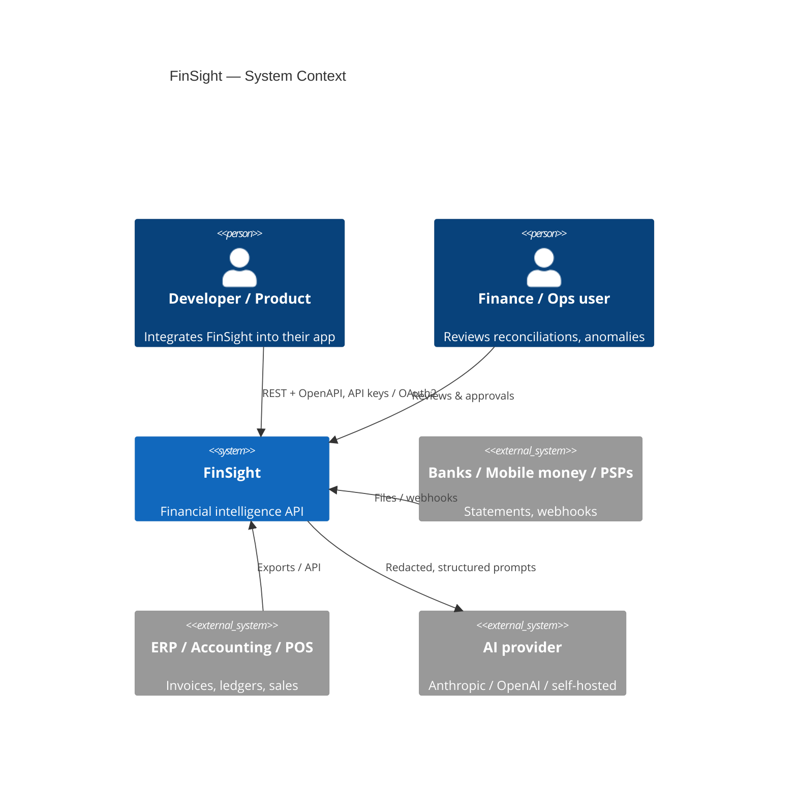
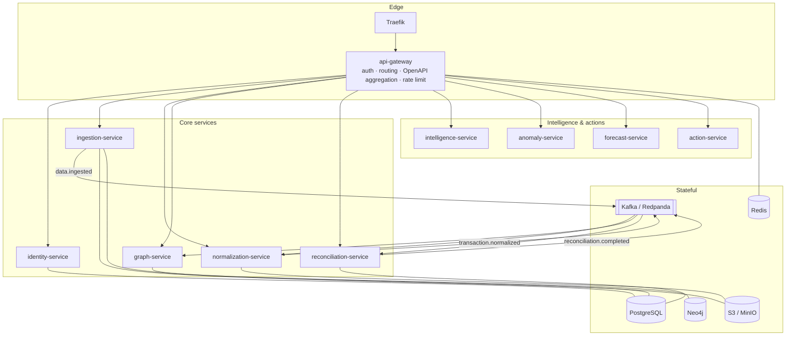

# FinSight — Architecture

## 1. Context



## 2. Containers



## 3. The data model

### Universal Financial Schema (`finsight_common.schemas.financial`)

Every inbound record — bank line, mobile-money transfer, invoice, receipt, POS sale, ledger
entry — becomes a `FinancialRecord`: typed, amount in integer **minor units**, ISO-4217
currency, resolved parties (with a canonical `normalized_name` for entity resolution),
`raw_ref` back to the original bytes, and a `confidence`.

### Financial graph (`graph-service`, Neo4j)

```
Customer ─PLACED→ Order ─BILLED_BY→ Invoice ←PAYS─ Payment ─SETTLED_BY→ BankTransaction ─HELD_IN→ Account
```

Nodes carry `(tenant_id, id)` uniqueness. The graph is what lets FinSight answer
"why is this payment unmatched?" and "what invoices are behind this bank line?".

## 4. Event backbone

JSON events wrapped in `EventEnvelope`, topic naming `finsight.<domain>.<event>.v<major>`.
Producers use the **transactional outbox** (`finsight_common.messaging.outbox_sql`) so a domain
write and its event commit atomically; a relay publishes to Kafka at-least-once. Consumers are
idempotent (dedupe on record / ingestion id).

| Event | Producer → Consumers |
|---|---|
| `data.ingested` | ingestion → normalization |
| `transaction.normalized` | normalization → graph, reconciliation, (anomaly) |
| `graph.updated` | graph → (intelligence) |
| `reconciliation.completed` | reconciliation → (notifications, audit) |
| `anomaly.detected` | anomaly → (action, notifications) |
| `audit.recorded` | every service → audit store |

## 5. Cross-cutting

* **Auth:** OAuth2 client-credentials + API keys → RS256 JWT (JWKS rotation). Per-endpoint
  scopes via `require_scopes(...)`. Hard tenant isolation on every query.
* **Observability:** OpenTelemetry traces (→ Jaeger), Prometheus `/metrics`, structlog JSON
  logs with `trace_id` correlation and PII redaction. `/health` + `/ready` on every service.
* **Errors:** RFC 9457 `application/problem+json` everywhere.
* **Config:** 12-factor via `pydantic-settings`, `FINSIGHT_` prefix.

## 6. Deployment topology (AWS)

VPC (3 AZ) · EKS managed node group · RDS PostgreSQL (Multi-AZ) · MSK (Kafka, TLS) ·
ElastiCache Redis · S3 (versioned, SSE-KMS) · ECR (immutable tags). Neo4j runs on EKS via its
Helm chart (swap path to Amazon Neptune: ADR 0004). Secrets via AWS Secrets Manager +
External Secrets Operator. Ingress via Traefik + cert-manager. GitHub Actions deploys through
OIDC (no static keys).

See [docs/adr/](docs/adr/) for the decisions behind all of this.
