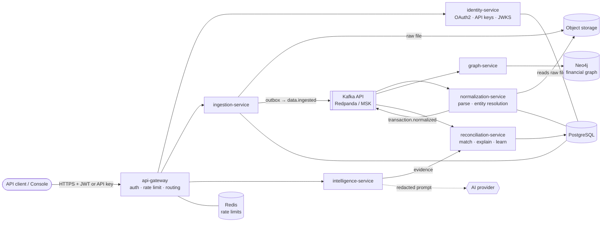

# FinSight

**The intelligence layer for financial data.**

[](https://github.com/manziosee/FinSight/actions/workflows/ci.yml)
[](https://github.com/manziosee/FinSight/actions/workflows/security.yml)
[](https://github.com/manziosee/FinSight/actions/workflows/fly-deploy.yml)

FinSight is an AI-powered financial-intelligence API. Give it whatever financial data a
business has — bank statements, mobile money, invoices, receipts, spreadsheets, POS,
payment gateways, ERP exports, in any format and any currency — and it connects, understands,
reconciles, explains, detects anomalies in, predicts, and acts on it.

Reconciliation is the entry point, not the product. The moat is handling **messy, fragmented,
multi-format, multi-currency** real-world financial data extremely well.

### Live

| | URL |
|---|---|
| API (gateway) | https://finsight-api-gateway.fly.dev |
| Interactive API docs | https://finsight-api-gateway.fly.dev/docs |
| OpenAPI spec | https://finsight-api-gateway.fly.dev/openapi.json |
| Console (reference UI) | https://finsight-console.fly.dev |

Hosted on [Fly.io](https://fly.io) in Johannesburg (`jnb`). See [deploy/fly](deploy/fly/README.md).

---

## Tech stack

| Layer | Technology |
|---|---|
| Services |      |
| Console |    |
| Events |   |
| Data |     |
| AI |  (bring-your-own-AI, offline fallback) |
| Observability |     |
| Runtime & edge |    |
| Cloud (AWS path) |     |
| CI/CD & security |      |

---

## How it works



1. **Authenticate.** A client exchanges OAuth2 client credentials for an RS256 JWT at
   `POST /v1/auth/token` (or sends an API key). Every service verifies tokens against
   identity-service's JWKS, and every query is scoped to the caller's tenant.
2. **Ingest.** `POST /v1/data/upload` stores the raw file in object storage and writes the
   ingestion row plus a `data.ingested` event in **one database transaction** (transactional
   outbox), so the event is never lost or published for data that wasn't saved.
3. **Normalize.** normalization-service reads the file and turns bank lines, mobile-money
   transfers and invoices in CSV, JSON, Excel or PDF into the **Universal Financial Schema**:
   integer minor units, ISO-4217 currency, resolved counterparties, a confidence score. It
   publishes `transaction.normalized`.
4. **Connect & reconcile.** graph-service links customers, invoices, payments and bank lines
   in Neo4j; reconciliation-service matches payments to invoices (partial, split, over/under
   payments), explains every match and leftover, and tunes its weights per tenant from human
   review decisions.
5. **Explain.** intelligence-service answers questions with evidence pulled live from
   reconciliation: the model narrates real numbers, it never invents them, and PII is
   redacted before anything reaches an AI provider.
6. **Track.** Poll `GET /v1/data/ingestions/{id}` for progress. Every state-changing call
   lands in the audit trail (`GET /v1/audit`).

Details: [ARCHITECTURE.md](ARCHITECTURE.md) and the decisions behind it in [docs/adr/](docs/adr/).

## Services

| Service | Role | Status |
|---|---|---|
| [api-gateway](services/api-gateway) | Auth, routing, unified OpenAPI, rate limiting | ✅ real |
| [identity-service](services/identity-service) | Tenants, OAuth2 clients, API keys, JWT/JWKS, audit trail | ✅ real |
| [ingestion-service](services/ingestion-service) | Accept raw data → object storage → `data.ingested` | ✅ real |
| [normalization-service](services/normalization-service) | Parse → Universal Financial Schema → `transaction.normalized` | ✅ real |
| [graph-service](services/graph-service) | Build & query the financial graph (Neo4j) | ✅ real |
| [reconciliation-service](services/reconciliation-service) | Match payments ↔ invoices with confidence, explanations, review loop | ✅ real |
| [intelligence-service](services/intelligence-service) | Evidence-grounded explain / ask (bring-your-own-AI) | ✅ real |
| [anomaly-service](services/anomaly-service) | Rule + statistical anomaly detection | 🧪 scaffold |
| [forecast-service](services/forecast-service) | Cash-flow forecasting & simulation | 🧪 scaffold |
| [action-service](services/action-service) | Approval-gated actions + AI-agent tool surface | 🧪 scaffold |
| [console](console) | Next.js reference UI: connect, upload, review queue, ask, audit | ✅ real |

Shared building blocks (app factory, auth, events, outbox, logging, telemetry) live in
[libs/finsight-common](libs/finsight-common).

---

## Infrastructure

FinSight runs the same containers in three environments.

### 1. Local — Docker Compose

| Piece | Local stand-in |
|---|---|
| Kafka | Redpanda |
| PostgreSQL | `postgres:16` (one database per service) |
| Graph | Neo4j Community |
| Object storage | SeaweedFS (S3 API) |
| Rate limits | Redis (password-protected) |
| Edge | Traefik → api-gateway |
| Observability | OpenTelemetry Collector → Jaeger, Prometheus, Grafana |

All host ports bind to `127.0.0.1` (set `FINSIGHT_BIND_ADDR=0.0.0.0` in `.env` to expose them).

| URL | What |
|---|---|
| http://localhost:3300 | **Console** |
| http://localhost:8088/docs | Unified FinSight API (Traefik → gateway) |
| http://localhost:18000/docs | Gateway directly (bypasses Traefik) |
| http://localhost:18081 | Swagger UI for the committed aggregated spec |
| http://localhost:16686 | Jaeger traces |
| http://localhost:13000 | Grafana (`admin` / `GRAFANA_ADMIN_PASSWORD` from `.env`) |
| http://localhost:18082 | Redpanda console (Kafka topics) |
| http://localhost:19001 | Object-storage browser (SeaweedFS filer) |

### 2. Fly.io — live

Every service is its own Fly app on Fly's private, WireGuard-encrypted network. Only the
gateway and the console are public. Redpanda, Neo4j and Redis run as private apps with
volumes; PostgreSQL is Fly Postgres with **one database and one user per service**; raw files
go to a Tigris bucket. Provisioning, secrets and deploys are scripted:
[deploy/fly/README.md](deploy/fly/README.md).

### 3. AWS — EKS (Terraform + Helm)

VPC across 3 AZs (NAT per AZ in production) · EKS with a private API endpoint · RDS PostgreSQL
(Multi-AZ, per-service logins, TLS enforced) · MSK (SASL/SCRAM over TLS) · ElastiCache Redis
(TLS + AUTH) · S3 (versioned, SSE-KMS) accessed through IRSA · ECR (immutable tags) · ALB with
WAF · GuardDuty + CloudTrail · secrets in AWS Secrets Manager via External Secrets Operator ·
Neo4j in-cluster. Default-deny NetworkPolicies, non-root read-only containers.
[deploy/terraform/README.md](deploy/terraform/README.md) · [deploy/helm/finsight](deploy/helm/finsight).

---

## Quick start (local)

Requires Docker and [uv](https://docs.astral.sh/uv/).

```bash
make bootstrap     # create .env and generate local secrets (Redis, Grafana, JWT key)
make up            # build & start the whole stack
make seed          # push demo invoices + a bank statement through the API
make smoke         # end-to-end check: token → upload → normalize → graph → reconcile
```

### Try it

```bash
BASE=http://localhost:8088   # or https://finsight-api-gateway.fly.dev
TOKEN=$(curl -s -X POST $BASE/v1/auth/token \
  -d grant_type=client_credentials -d client_id=demo-client -d client_secret=demo-secret \
  | jq -r .access_token)

curl -s -X POST $BASE/v1/transactions/understand \
  -H "Authorization: Bearer $TOKEN" -H 'Content-Type: application/json' \
  -d '{"transaction":{"amount":850000,"currency":"RWF","description":"ABC LTD PMT INV 439","date":"2026-08-28"}}' | jq
```

`demo-secret` is the local default from `.env.example`. On Fly, the demo client's secret is
generated by `deploy/fly/provision.sh` and kept in your local `deploy/fly/secrets.env`.

## Development

```bash
make install    # uv sync the workspace
make lint       # ruff + ruff format --check + mypy
make test       # unit tests
make test-all   # + integration tests (needs Docker)
make openapi    # regenerate docs/api/*.openapi.json (CI fails if they're stale)
```

Coding standards and the contribution flow: [CONTRIBUTING.md](CONTRIBUTING.md).

## CI/CD

| Workflow | What it does |
|---|---|
| [`ci.yml`](.github/workflows/ci.yml) | Lint, unit tests, OpenAPI drift check, console build, Terraform/Helm validation, image builds, full-stack e2e smoke test |
| [`security.yml`](.github/workflows/security.yml) | Gitleaks, Bandit, pip-audit, Semgrep, Trivy image scans, Checkov |
| [`fly-deploy.yml`](.github/workflows/fly-deploy.yml) | Deploys to Fly after CI passes on `main` (needs the `FLY_API_TOKEN` secret) |
| [`cd-staging.yml`](.github/workflows/cd-staging.yml) / [`cd-production.yml`](.github/workflows/cd-production.yml) | EKS: build → push to ECR → Helm upgrade, via GitHub OIDC (no static AWS keys) |

## Security

Tenant isolation on every query, scoped tokens, per-service database users, encrypted
transport and storage, PII redaction in logs and AI prompts, and an audit trail of every
mutation. Report vulnerabilities privately: [SECURITY.md](SECURITY.md).

## Repository layout

```
services/          one FastAPI service per directory (src/, tests/, migrations/)
libs/              finsight-common: shared app factory, auth, events, outbox, telemetry
console/           Next.js reference UI
deploy/fly/        Fly.io apps, provisioning and deploy scripts
deploy/helm/       Helm chart for EKS
deploy/terraform/  AWS infrastructure (modules + staging/production)
infra/             local Compose config (observability, Postgres init, object storage)
docs/              ADRs, runbooks, threat model, generated OpenAPI specs
```
